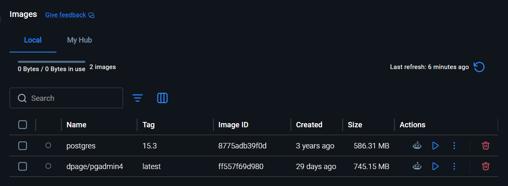
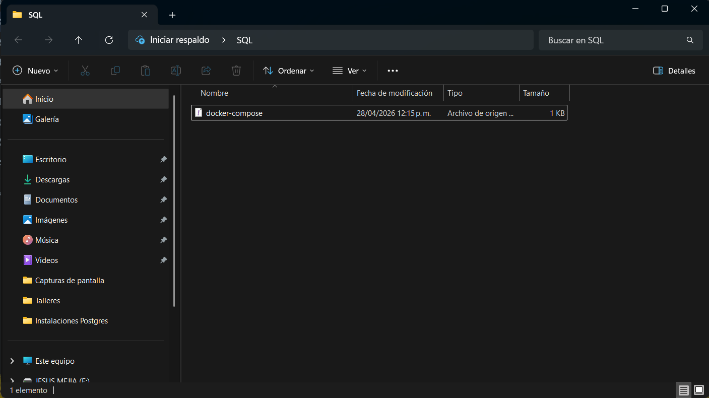
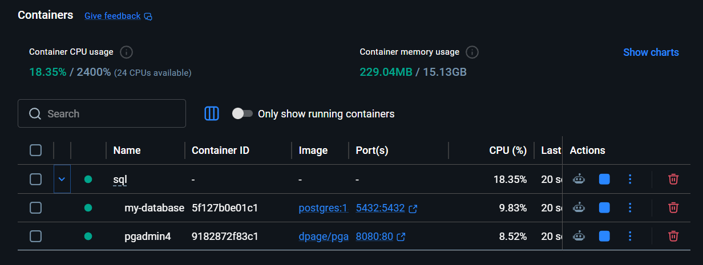

# Instalaciones Para el Curso

## [Docker Desktop](https://www.docker.com/get-started/)

Es una herramienta que permite crear y ejecutar contenedores, es decir, entornos aislados donde puedes correr aplicaciones sin instalar todo directamente en tu sistema. En bases de datos, se usa para levantar servicios como MySQL o PostgreSQL de forma rápida y limpia, facilitando pruebas y desarrollo sin afectar tu computadora.

## [Table Plus](https://tableplus.com/)

Es una aplicación gráfica para gestionar bases de datos de manera sencilla. Permite conectarte a diferentes motores (MySQL, PostgreSQL, etc.), ejecutar consultas SQL y visualizar o editar datos sin usar la terminal, lo que la hace muy útil para administración y análisis.

## [Visual Studio Code](https://code.visualstudio.com/)

Es un editor de código que se utiliza para desarrollar aplicaciones. En relación con bases de datos, se usa para escribir el código que se conecta a ellas, hacer consultas mediante extensiones y gestionar proyectos donde la base de datos forma parte del sistema.

# Guia Para Ejecutar Mi Imagen de Docker

## Paso 1

Verificar Instalación de Docker Desktop

```bash
docker --version
```

## Paso 2

Instalar mas imagenes de Postgres y PgAdmin

```bash
docker pull postgres:15.3
```

```bash
docker pull dpage/pgadmin4
```

## Paso 3

Verificar que las Imagenes esten en el Docker Desktop



## Paso 4

Crear una carpeta como espacio de trabajo para la base de datos


## Paso 5

Pegar el archivo docker-compose.yml en la carpeta creada como espacio de trabajo



## Paso 6

Ejecutar el siguiente comando para crear un Contenedor basado en las imagenes de Postgres y PgAdmin

**Importante, tenemos que ejecutar el comando al nivel del docker-compose.yml**

```bash
docker compose up -d
```

**Bajar servicios**

```bash
docker compose down
```

## Paso 7

Verificar en Docker Desktop el Contenedor creado de forma exitosa

